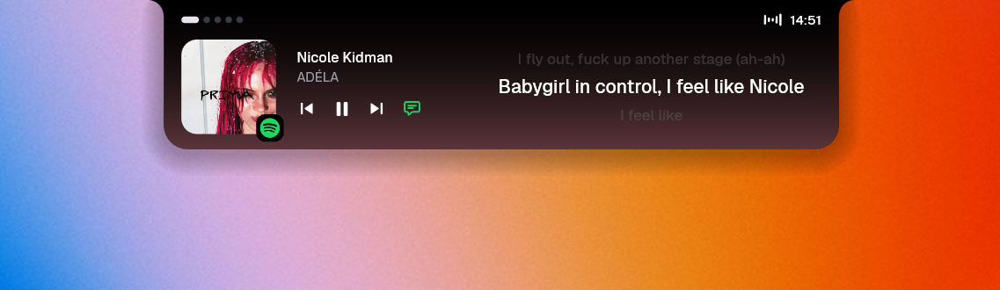

# Notch


A tiny notch for the top of your Windows screen, written in Rust. It sits at the top edge as a slim black pill, and opens when you hover over it. While music plays, it shows the track and scrolls the synced lyrics inline, line by line. It also keeps a file shelf, a calendar, a focus timer and system stats, and shows short messages (volume, notifications, Caps Lock) in the pill.

The notch draws straight to the screen with Direct2D: no UI framework, no web view. Every page and every pill message is its own module. Pages can be disabled; notifications are the only optional activity. A settings window, opened from the tray menu, is a separate program, so it adds nothing to the notch while closed. See [Resource use](#resource-use) for measured CPU and memory.



## What it includes

Pages (what you see when you open the notch; the time sits in the header of every one):

- Media player with synced lyrics; with lyrics off, the collapsed pill fits the song title up to 400 DIP wide
- The idle pill is 36 DIP tall (33 DIP content + 3 DIP bottom padding), with a minimum width of 150 DIP.
- The outer curves joining the top screen edge use a 6 DIP radius when idle and 12 DIP when open.
- File shelf: drop files to keep them for a while
- Calendar: the week and the events of a day you pick
- Focus timer
- System stats (off until you add it)

Activities (what the collapsed pill shows while something happens):

- Volume
- Brightness
- Charger and battery
- Bluetooth devices
- Microphone in use
- Camera in use
- Copied to the clipboard
- Caps Lock on and off
- Windows notifications: the pill opens into a banner with the app's logo for a few seconds, between its idle and open sizes; point at it to keep it on screen; a message that was cut short grows taller to show all of its text

### Maximized and full-screen windows

Over a **maximized** window the notch hides to a thin strip at the very top edge and wakes when the pointer waits there. Volume, notifications and other short messages still show. **Show lyrics over maximized windows** is on by default, keeping active lyrics visible. Turn on **Show notch over maximized windows** to keep all notch content visible, including music without lyrics and the idle clock. This option is off by default and takes precedence over **Hide when idle** on maximized windows. **Hide for full-screen apps**, on by default, independently hides the entire notch over a game, video or F11 window.

### Status marks

While the notch is open, small marks beside the time show what is going on: the wave while music plays, a ring while a focus timer runs, a crossed speaker while the sound is muted, and an arrow while Caps Lock is on.

### Extensible

The tray menu can switch **Notifications** on or off; the other activities are always enabled. The **Settings…** window changes the options, orders pages and switches them on or off, and the notch applies each change at once; the same keys can be edited in the settings file (the **Edit pages** view in the notch is switched off; see [docs/configuration.md](docs/configuration.md)). To go further, write your own page or activity: each is one folder or file and one line in a registry, with no other code to touch. See [docs/adding-a-page.md](docs/adding-a-page.md) and [docs/adding-an-activity.md](docs/adding-an-activity.md).

### Limitations

- Windows only, on the primary display, centered at the top. Multiple monitors and display changes while running get no special handling; only the window in front on the primary display is looked at. The display scale is read once at start-up.
- Microphone and camera show that an app has the device **open**, not that it is recording. An app that keeps the microphone open while you are muted (Google Meet in a browser) keeps the orange dot. The microphone follows the default recording device at start-up. The camera is found through the Windows Frame Server log, so it misses some older DirectShow apps and a camera already on at start-up. This was built on Windows 11 build 26300; other versions are untested.
- Notifications show a few seconds after Windows shows their own banner, and only as a banner: there is no list of past ones, and the banner has no buttons (the buttons of the notification itself are not available to it). The text of a message can be left out with `notifications.show_text=off` in the settings file.
- Calendar reads an iCal address, not a Google sign-in. A daylight-saving event can show an hour off.
- The file shelf keeps the paths of files, not copies. Dragging a file out copies it and never moves or deletes the original.
- The open notch is 86 px high for every page, so the calendar lists two events at a time.
- Brightness follows the laptop panel only.
- Version 0.1: expect rough edges.

## How to use it

- **Hover** over the pill to open it; move away to close it with a small bounce into the idle state.
- **Pages:** scroll the wheel (or swipe two fingers on a touchpad) or click a dot. Touchpad scrolling follows your fingers and gently centers the nearest page after input stops. Each page keeps its own width, and the notch gradually changes width with the swipe. The wheel and page dots use a firmer transition. Pages loop, and the notch opens on the page you left.
- **Media:** click the buttons; the speech-bubble button turns lyrics on and off.
- **Shelf:** drag files onto the notch (it turns blue when it is ready). The shelf shows six places; when there are more files, the last place shows the overflow count. Double-click a file to open it, drag it out to take it off the shelf into another app, and right-click it or press the cross on its corner to remove it.
- **Calendar:** click a day of the week to list its events.
- **Calendar:** copy your calendar's iCal address, then right-click the tray icon and choose **Use calendar link from clipboard**. For Google Calendar, use "Secret address in iCal format" and treat it like a password.
- **Tray menu** (right-click the tray icon; the notch itself has no menu): **Notifications**, the calendar link, **Hide when idle**, **Hide for full-screen apps**, **Show notch over maximized windows**, **Show lyrics over maximized windows**, **Start with Windows**, **Settings…**, and **Quit**. On Windows 11 the icon may sit under the `^` overflow menu.

| Option | Default |
| --- | --- |
| Notifications | On |
| Hide when idle | Off |
| Hide for full-screen apps | On |
| Show notch over maximized windows | Off |
| Show lyrics over maximized windows | On |
| Start with Windows | On in the installer |

Defaults apply when no choice has been saved; existing notification, visibility and startup choices are retained.

After unlocking or resuming Windows, Notch restores its position above app windows and resets hover so the hidden
strip can open again, without taking focus from the app you are using.

The orange folded-tab logo identifies Notch in the tray, File Explorer, the installer, the installed-app list and Start search.

## Device requirements

- Windows 10 or 11, 64-bit (tested on Windows 11)
- For the media page: a player that appears in the Windows media controls
- Internet only for lyrics and a calendar link (see [Privacy](#privacy))

## Download

Download `notch-<version>-windows-x64-setup.exe` from the [latest release](https://github.com/hibatillah/notch/releases/latest) and run it. The installer is not code-signed, so Windows may show a SmartScreen warning. The notch starts with Windows unless you untick that in the installer or in the tray menu (**Start with Windows**). Or clone the repository and build it yourself; see [Development](#development).

### Updating

Notch has no automatic update. It does not look for new versions, because the only things it connects to the internet for are lyrics and a calendar link you set yourself (see [Privacy](#privacy)). To update, download the newer `-setup.exe` from the [releases](https://github.com/hibatillah/notch/releases) page and run it. The installer sees that Notch is already installed, says which version is installed and which one it would put in its place, and asks whether to continue. If you say yes it closes the running notch, replaces it in place and starts it again. You do not uninstall the old version first, and your settings stay.

## Contributing

This project does not take contributions: pull requests and issues may be ignored. Clone or fork it and change your copy. [docs/architecture.md](docs/architecture.md) explains how the code is organized.

## Development

Requirements for building (running a built `notch.exe` needs only Windows 10 or 11):

- [Rust](https://rustup.rs) 1.88 or newer (tested with 1.97)
- Visual Studio Build Tools with the **Desktop development with C++** workload (MSVC linker and Windows SDK)
- Git Bash, only for the `scripts/*.sh` helpers
- To build the settings window (`notch-settings`), the MSVC Rust toolchain (`stable-x86_64-pc-windows-msvc`); the default `cargo build` builds only the notch

Build and run:

```
git clone https://github.com/hibatillah/notch.git
cd notch
cargo build --release
target\x86_64-pc-windows-msvc\release\notch.exe
```

While developing, run `scripts/watch.sh` from Git Bash to rebuild and relaunch on every save, or `scripts/reload.sh` for a single release build. It builds, starts the new build and closes the previous one without a gap (a running `.exe` cannot be overwritten on Windows).

Before finishing a change:

```
cargo fmt --check
cargo clippy --all-targets -- -D warnings
cargo test
scripts/perf.sh
```

Tests sit at the bottom of the source file they test. `scripts/perf.sh` measures the memory and CPU of a running notch.

| Doc                                            | What it covers                                                                      |
| ---------------------------------------------- | ----------------------------------------------------------------------------------- |
| [docs/development.md](docs/development.md)     | requirements, build, run, development loop, checks, code style, dependency licenses |
| [docs/testing.md](docs/testing.md)             | where the tests live, how to write one, the performance check                       |
| [docs/performance.md](docs/performance.md)     | measured CPU/RAM, workloads and measurement limits                                 |
| [docs/architecture.md](docs/architecture.md)   | how the code is organized                                                           |
| [docs/adding-a-page.md](docs/adding-a-page.md) | write, register and remove a page                                                   |
| [docs/adding-an-activity.md](docs/adding-an-activity.md) | write, register and remove an activity                                    |
| [docs/configuration.md](docs/configuration.md) | which pages and activities are on, settings file, environment variables             |
| [docs/releasing.md](docs/releasing.md)         | the CI and release workflows, and how to publish a release                          |

For an AI coding agent, [CLAUDE.md](CLAUDE.md) and `.claude/rules/` hold the project rules.

## Resource use

Latest recorded baseline: **2026-10-28**, after the convention audit, using `scripts/perf.sh --no-build`.
Windows 11 Home build 26300, Ryzen 5 8645HS, 15.3 GiB usable RAM; Rust 1.97.1, Windows x64 release build.
The test used the shelf page, existing activity settings, 20-second idle samples and 10 open/close cycles.
CPU is a percentage of **one core**; RAM is **private working set** in MiB.

| Measurement | Result |
| --- | ---: |
| Collapsed idle CPU | 0.078% |
| Initial RAM | 22.1 MiB |
| CPU time per open/close cycle | 131 ms |
| RAM growth over 10 cycles | 0.5 MiB |
| Handle growth over 10 cycles | -8 |
| Hover events | 20/20 |
| Idle CPU after cycles | 0% |

All baseline checks passed in this run. Earlier runs intermittently exceeded CPU and memory-growth limits;
one passing sample does not establish their cause or guarantee the same result on every machine.
Music playback, live lyrics, held hover and swiping were not measured in this latest baseline.

These figures are for `notch.exe`. The settings window is a separate process with a higher footprint while it is open; see [docs/performance.md](docs/performance.md#settings-window).

Run `scripts/perf.sh` to repeat the baseline, or add `--extended` for held hover and swiping.
The check moves the mouse and replaces the running Notch; afterwards run `scripts/reload.sh` to restore normal pages.
See [docs/testing.md](docs/testing.md) for options and limits.

## Privacy

Notch is a local program. You download it and it runs on your computer, with no account and no analytics. It reads what is playing, your notifications (their text and app), the clipboard state and your shelf files only on your machine, and never reads what you copy. It sees which window is in front only to tell whether it is maximized or full screen. For Caps Lock it installs a keyboard hook that looks at that one key and keeps nothing it sees. Settings stay in `%APPDATA%\notch\settings.txt`, and a "Start with Windows" entry is added under your user's `Run` key unless you untick it.

It connects out for two things only:

- **Lyrics:** when a track starts, it asks [LRCLIB](https://lrclib.net) for synced lyrics, sending the artist, title, album and length. The player itself (Spotify, a browser) is only read through Windows, never contacted. Set `NOTCH_LYRICS=off` to stop lookups; the lyrics button only hides them.
- **Calendar:** if you set a calendar link (for example Google Calendar's iCal address), it downloads that file every 15 minutes. The link sits in the settings file, so treat that file like a password.

## Acknowledgements

Notch is heavily inspired by Apple's Dynamic Island, and by the apps that bring the same idea to screens that have no hardware notch: [NotchNook](https://lo.cafe/notchnook) for the Mac and [Nusa](https://rama2555.github.io/nusa/) for Windows. They showed what a notch overlay can hold and how it should feel: the media player, the file shelf, the calendar and the short messages that open the pill.

Notch itself is written independently, from scratch in Rust. It draws with Direct2D and uses no UI framework (only its separate settings window does), and every page and every pill message is its own module, so you can remove one or write your own. It is open source under the MIT license: clone or fork it and change your copy (see [Contributing](#contributing)).

Notch is not affiliated with or endorsed by Apple, NotchNook, Nusa or their developers. Dynamic Island is a trademark of Apple Inc., and the other names belong to their owners.

## License

[MIT](LICENSE)
